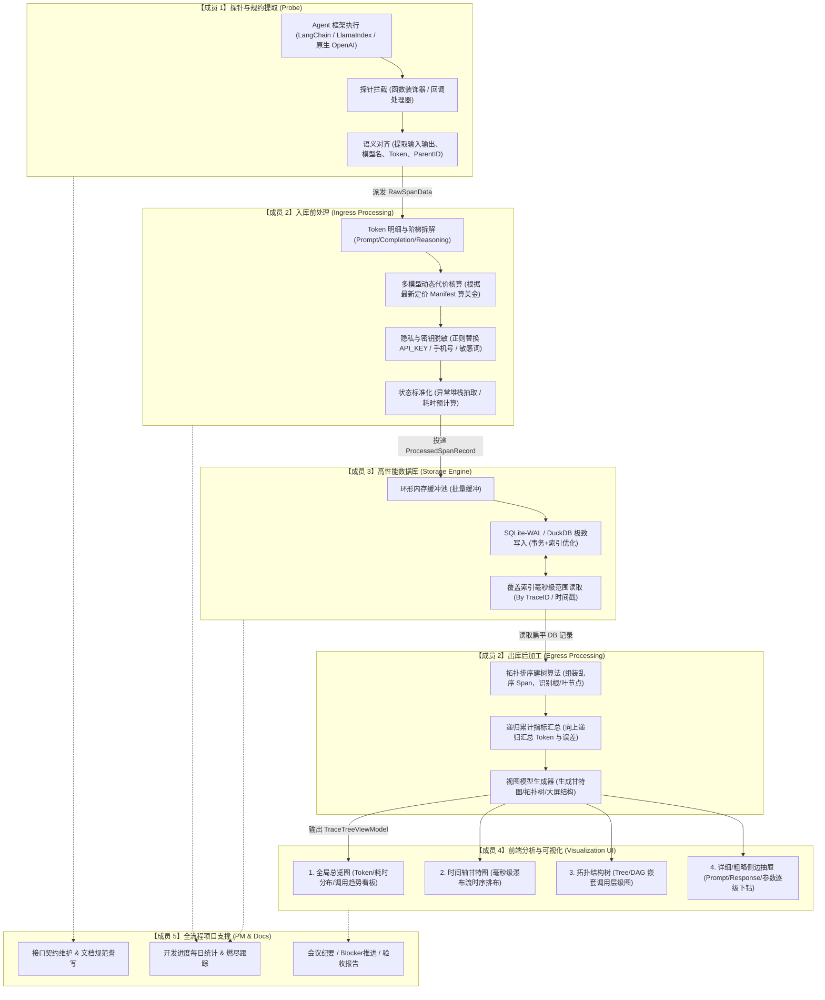

# 本地一体化 AI Agent 可观测性平台：五人团队分工与技术架构指南

> **设计宗旨**：
> 移除复杂的跨网络传输（gRPC / HTTP OTLP），构建**“本地 Agent 运行 $\to$ 内存直连探针 $\to$ 数据处理中枢 $\to$ 极致本地数据库 $\to$ 可视化分析大屏”**的一体化轻量级极速运行架构。  
> 团队 **4 位核心开发** 专注核心业务流水线（不引入复杂的分支查询与过滤节点），**1 位文档与进度管理成员** 全程维护文档演进、进度统计、会议纪要与交付物誊写，保障项目高效交付。

---

## 目录
1. [系统总体流水线与交互架构](#1-系统总体流水线与交互架构)
2. [数据流全链路流转图解](#2-数据流全链路流转图解)
3. [五人团队详细分工与核心职责](#3-五人团队详细分工与核心职责)
   - [成员 1（探针）：多 Agent 框架拦截与协议规约化](#成员-1探针多-agent-框架拦截与协议规约化)
   - [成员 2（数据处理）：进出库信息处理、代价格算与建树算法](#成员-2数据处理进出库信息处理代价格算与建树算法)
   - [成员 3（数据库）：极致高性能本地存储与快速读写响应](#成员-3数据库极致高性能本地存储与快速读写响应)
   - [成员 4（前端）：多维可视化图表与时间轴树状大屏](#成员-4前端多维可视化图表与时间轴树状大屏)
   - [成员 5（文档与项目管理）：文档维护、进度统计、会议记录与成果誊写](#成员-5文档与项目管理文档维护进度统计会议记录与成果誊写)
4. [核心数据契约（开发人员协作的接口协议）](#4-核心数据契约开发人员协作的接口协议)
5. [核心算法深度详解（成员 2 的建树与指标聚合）](#5-核心算法深度详解成员-2-的建树与指标聚合)
6. [五人团队协作落地与联调里程碑](#6-五人团队协作落地与联调里程碑)

---

## 1. 系统总体流水线与交互架构

由于完全在本地运行，探针不再将数据打包为网络数据包，而是通过**进程内内存管道（In-Process Channel / Queue）**直接传递给数据处理层；处理后的数据写入本地极致优化的嵌入式数据库（推荐 SQLite-WAL 或 DuckDB）；前端直接从本地服务端/渲染进程获取组装完毕的视图模型（View Model）进行交互呈现。

```
┌─────────────────────────────────────────────────────────────────────────────┐
│                             本地单进程 / 一体化应用                          │
│                                                                             │
│   ┌────────────────┐      内存直传       ┌──────────────────────────────┐   │
│   │  成员 1: 探针   │  RawSpanData 对象  │      成员 2: 数据处理中枢     │   │
│   │ (多框架 Hook)  ├───────────────────►│ (Token/代价/脱敏/指标加工)     │   │
│   └────────────────┘                    └──────┬───────────────────────┬┘   │
│                                                │ 结构化写入             │ 树形/看板转换│
│                                                ▼ 入库前                 ▼ 出库后   │
│                                         ┌──────────────┐       ┌────────────┐│
│                                         │ 成员 3: 数据库│       │ 成员 4: 前端││
│                                         │ (极致读写引擎)│◄──────┤ (多维可视化)││
│                                         └──────────────┘ 读取   └────────────┘│
└──────────────────────────────────────┬──────────────────────────────────────┘
                                       │ 全流程接口对齐 / 进度跟踪 / 交付物归档
                                       ▼
                    ┌──────────────────────────────────────┐
                    │     成员 5: 文档管理与项目进度跟踪     │
                    │  (文档维护 / 进度统计 / 成果誊写 / 演示)│
                    └──────────────────────────────────────┘
```

---

## 2. 数据流全链路流转图解



---

## 3. 五人团队详细分工与核心职责

### 成员 1（探针）：多 Agent 框架拦截与协议规约化
* **核心定位**：最前线的“数据捕手”，让不同 Agent 框架产生的混乱数据在产生的第一时间完成规约化。
* **负责模块**：`probe/`
* **具体要做什么**：
  1. **主流框架适配器（Framework Adapters）**：
     - **原生 SDK 拦截**：针对 `OpenAI`、`Anthropic`、`DeepSeek` 原生调用进行 Monkey-patching，劫持 `chat.completions.create`。
     - **LangChain / LangGraph 适配**：实现统一的 `BaseCallbackHandler`，监听 `on_chain_start/end`、`on_llm_start/end`、`on_tool_start/end`。
     - **LlamaIndex 适配**：接入其全局 `Dispatcher` 捕获 QueryEngine 和 Retriever 的事件。
  2. **上下文追踪与 ID 传播（Context Propagation）**：
     - 维护本地线程安全或协程安全的上下文栈（基于 Python `contextvars.ContextVar`）。
     - 负责自动生成 `trace_id`（整条链唯一）、`span_id`（当前节点唯一），并在调用发生时自动获取栈顶的 `parent_id` 建立父子嵌套关系。
  3. **语义规约清洗（Semantic Alignment）**：
     - 抹平各框架的命名差异，统一提取为四类核心节点类型：`AGENT`、`CHAIN`、`TOOL`、`LLM`。
     - 提取输入与输出的文本内容（Input/Output），防止非结构化对象导致崩溃。
* **交付成果**：一套即插即用的探针初始化入口 `init_tracer()` 和针对各框架的无侵入式包装器，输出标准的 `RawSpanData` 内存对象给成员 2。

---

### 成员 2（数据处理）：进出库信息处理、代价格算与建树算法
* **核心定位**：全链路的“数据中枢与算法大脑”，负责**数据库进之前、出之后**的所有复杂计算，是探针、数据库、前端三者的胶水层。
* **负责模块**：`processor/`
* **具体要做什么**：
  1. **入库前处理（Ingress Processing）——【数据库进之前】**：
     - **Token 细分与消耗提取**：
       - 不仅处理基础的 `prompt_tokens` 与 `completion_tokens`，更需要前瞻性支持国产模型（如 DeepSeek-R1）的 **`reasoning_tokens`（思维链消耗）**、**`cache_read_tokens`（缓存命中）**、**`cache_write_tokens`**。
     - **多模型代价格算引擎（Cost Calculator）**：
       - 维护一个本地的模型费率清单（`model_price_manifest.json`）。
       - 根据模型名（如 `gpt-4o`, `deepseek-chat`, `claude-3-5-sonnet`）精确计算美金/人民币花费（如每百万 Token 单价换算）。
     - **安全与敏感数据脱敏（Data Sanitizer）**：
       - 采用正则规则与字典，对用户输入的明文 API 密钥（如 `sk-***`）、手机号、身份证号进行遮罩脱敏（替换为 `<REDACTED>`）。
     - **错误与状态规范化**：
       - 捕获异常堆栈，将复杂的 Python Exception 转化为结构化的 `status_code="ERROR"`、`error_type` 和纯文本摘要。
  2. **出库后处理（Egress Processing）——【数据库出之后去前端】**：
     - **扁平数据到树结构的组装算法（Tree Construction Algorithm）**：
       - 数据库查出来的只是一堆平铺的行记录，必须通过拓扑排序算法，在 $O(N)$ 时间复杂度内将其构造成符合前端展示的嵌套 JSON 树。
       - **孤儿节点容错**：应对子节点先于父节点完成、或者缺失父节点等现实异常场景，自动挂载到虚拟根节点。
     - **递归指标向上累加（Recursive Aggregation）**：
       - 根节点需要展现整个调用链的总耗时、总花费、总 Token、错误节点总数。该算法递归遍历树，将叶子节点的指标汇总到各级父节点。
     - **前端可视化模型转换（View Model Converter）**：
       - 将树转换为成员 4 前端所需的专门格式：时间轴甘特图格式（计算相对偏移时间）、拓扑图格式、全局指标看板摘要。
* **交付成果**：`IngressProcessor`（入库前清洗计算并输出 `ProcessedSpanRecord`）和 `EgressProcessor`（读取数据并算法建树，输出 `TraceTreeViewModel` 与 `DashboardMetrics`）。

---

### 成员 3（数据库）：极致高性能本地存储与快速读写响应
* **核心定位**：稳定高速的“数据地基”，负责单机环境下极致的写入并发与微秒级点查。
* **负责模块**：`storage/`
* **具体要做什么**：
  1. **本地嵌入式数据库架构选型与配置**：
     - 采用 **SQLite（结合 WAL 模式）** 或 **DuckDB** 作为单一本地存储引擎（零安装、零运维）。
     - **PRAGMA 极致性能调优**：
       ```sql
       PRAGMA journal_mode = WAL;          -- 读写互不阻塞
       PRAGMA synchronous = NORMAL;        -- 兼顾性能与安全
       PRAGMA busy_timeout = 5000;         -- 5秒锁等待，消除锁定报错
       PRAGMA cache_size = -64000;         -- 预留 64MB 页面内存缓存
       ```
  2. **高频精简表结构设计（Schema Optimization）**：
     - `traces` 表：记录调用链宏观信息（`trace_id`, `project_name`, `start_time`, `end_time`, `total_latency_ms`, `total_tokens`, `total_cost`, `status`）。
     - `spans` 表：记录单步执行细节（`span_id`, `trace_id`, `parent_id`, `span_kind`, `name`, `start_time`, `end_time`, `latency_ms`, `input`, `output`, `attributes`, `token_breakdown`, `cost`）。
  3. **批量写入与事务隔离（Bulk Ingestion）**：
     - 实现内存环形缓冲（Buffer），每攒齐 50 个 Span 或超过 200ms 触发一次批量原子 `COMMIT`，避免单条写入频繁触发磁盘 IO。
     - 针对单条损坏数据的防护：支持 Savepoint 局部隔离，一条格式损坏不至于整批丢弃。
  4. **极致点查与快速响应接口**：
     - 针对前端常用页面设计覆盖索引（Covering Index）：
       - `CREATE INDEX idx_spans_trace_id ON spans(trace_id, start_time);`
       - `CREATE INDEX idx_traces_time ON traces(start_time DESC);`
     - 提供纯 Python 极速调用接口：
       - `save_spans(batch: list[ProcessedSpanRecord]) -> None`
       - `get_trace_by_id(trace_id: str) -> list[SpanRecord]`（单次查询耗时控制在 5ms 以内）
       - `get_recent_traces(limit: int) -> list[TraceSummary]`（供列表展示）
* **交付成果**：`LocalDatabaseEngine` 模块，包括数据库初始化建表脚本、连接生命周期管理、批量写入函数与快速读取查询接口。

---

### 成员 4（前端）：多维可视化图表与时间轴树状大屏
* **核心定位**：直观易懂的“用户视觉之窗”，将底层枯燥的字典和数字变成一目了然的可视化界面。
* **负责模块**：`frontend/`（可用 React + Tailwind / Vue / 甚至轻量 Streamlit / Gradio，视技术栈定）
* **具体要做什么**：
  1. **时间轴甘特图组件（Timeline / Waterfall View）**：
     - **横轴**为时间（毫秒级刻度），**纵轴**为调用层级。
     - 每个 Span 显示为一个条形块，起点对应 `start_time`，宽度对应 `latency_ms`。
     - 不同 `span_kind` 使用色彩区分（如 LLM 为紫色、Tool 为橙色、Chain 为蓝色），直观展现哪一步在拖慢整个 Agent。
  2. **嵌套调用树状组件（Nested Tree View）**：
     - 树形折叠组件，展示 `Agent -> Step 1 -> Tool -> LLM` 的树状父子从属关系。
     - 节点上挂载关键徽章（Badges）：耗时（如 `120ms`）、Token（如 `580 tokens`）、单步花费（如 `$0.0012`）。
  3. **全局总览仪表盘（Overview Dashboard）**：
     - **核心指标卡片**：总调用次数、平均延迟、累计消耗 Token、总花费金额。
     - **简单分布图**：最近调用的 Token 消耗趋势折线图、不同工具（Tool）使用频次饼图。
  4. **逐级下钻侧边抽屉（Details Drawer）**：
     - 点击甘特图或树上的任意一个节点，在右侧滑出详细信息抽屉。
     - **粗略/详细两档切换**：
       - *粗略视图*：仅显示输入提问、输出回答、耗时与 Token。
       - *详细视图*：展示完整的 System Prompt、LLM 生成参数（temperature 等）、完整的 JSON 格式化属性、异常报错 Traceback。
* **交付成果**：一个可以本地独立打开的前端界面，包含仪表盘总览页与 Trace 瀑布流详情分析页，对接成员 2 的 View Model 数据。

---

### 成员 5（文档与项目管理）：文档维护、进度统计、会议记录与成果誊写
* **核心定位**：团队的“协调中枢与交付守护者”，负责将 4 位核心开发的零散产出统一转化为规范化工程资产，确保项目按期、高质量交付。
* **负责模块**：`docs/`、项目管理看板与验收报告
* **具体要做什么**：
  1. **文档全周期维护与规范誊写（Documentation Engineering）**：
     - **统一接口字典维护**：跟踪并实时更新成员 1、2、3、4 之间的 3 大数据契约，防止因口头约定变更导致联调踩坑。
     - **项目架构与技术报告誊写**：将各成员的技术实现整理为清晰规范的《系统设计说明书》与《使用手册（README）》，统一定义专业术语和图表风格。
     - **安装部署与快速启动指南**：编写“5 分钟本地一键跑通指南”，验证新机器环境依赖是否完整。
  2. **开发进度统计与任务看板跟踪（Progress Tracking）**：
     - **任务拆解（WBS）与甘特表统计**：建立并维护每周任务清单，统计 4 位成员的代码交付进度百分比与燃尽曲线。
     - **阻塞项（Blocker）登记与推进**：每日同步各成员遇到的依赖阻塞（如前端等后端接口、数据处理等探针字段），及时拉齐解决。
     - **每周/每日进度报告誊写**：产出清晰简洁的进度周报与完成情况汇总。
  3. **会议纪要与技术决策记录（Meeting & ADR）**：
     - 负责团队讨论会、接口评审会的会议纪要誊写，重点记录结论与 Action Items。
     - 维护架构决策记录（Architecture Decision Record, ADR），例如记录为何选 SQLite-WAL 而非 MySQL、为何采用 $O(N)$ 组装树等决策背景。
  4. **交付物归档与成果汇报材料制作（Delivery & Presentation）**：
     - 收集整理测试运行数据，输出功能完备性统计表格。
     - 制作终期答辩/成果展示文稿（PPT / Slides）。
     - 录制本地一体化运行的操作演示视频（录屏），截图归档核心页面（甘特图、树状图、大屏看板）。
* **交付成果**：一套完备的《项目设计与接口文档》、持续更新的《进度统计周报/看板》、一份高质量的《成果汇报 PPT》与运行演示视频。

---

## 4. 核心数据契约（四人协作的接口协议）

为了让 4 位核心开发在第一天就能各自写代码，同时由**成员 5 负责督促与冻结**以下 3 个**数据接口标准**。

### 契约 1：探针 $\to$ 数据处理（`RawSpanData`）
* **提供者**：成员 1
* **消费者**：成员 2
```python
from dataclasses import dataclass, field
from datetime import datetime
from typing import Any, Optional

@dataclass
class RawSpanData:
    trace_id: str                      # 全局 Trace ID
    span_id: str                       # 当前 Span ID
    parent_id: Optional[str]           # 父 Span ID（根节点为 None）
    name: str                          # 节点名称，如 "ChatOpenAI" / "WebSearchTool"
    span_kind: str                     # "AGENT" | "CHAIN" | "LLM" | "TOOL"
    start_time: datetime               # 开始时间戳
    end_time: datetime                 # 结束时间戳
    input_data: Any                    # 原始入参（文本或字典）
    output_data: Any                   # 原始输出
    model_name: Optional[str] = None   # 若为 LLM，记录模型名 (如 "gpt-4o")
    raw_tokens: dict[str, int] = field(default_factory=dict) # 原始 token 字段
    status: str = "OK"                 # "OK" | "ERROR"
    error_message: Optional[str] = None
    metadata: dict[str, Any] = field(default_factory=dict)
```

---

### 契约 2：数据处理 $\to$ 数据库（`ProcessedSpanRecord`）
* **提供者**：成员 2
* **消费者**：成员 3（落盘），后续出库时原样查出
```python
@dataclass
class ProcessedSpanRecord:
    span_id: str
    trace_id: str
    parent_id: Optional[str]
    span_kind: str
    name: str
    start_time: str                    # ISO 格式字符串，便于数据库存储
    end_time: str
    latency_ms: float                  # 毫秒耗时
    input_str: str                     # 脱敏后的 JSON 文本
    output_str: str                    # 脱敏后的 JSON 文本
    prompt_tokens: int
    completion_tokens: int
    total_tokens: int
    cost_usd: float                    # 算出的美金代价
    status: str
    error_message: Optional[str]
    attributes_json: str               # 其他自定义元数据
```

---

### 契约 3：数据处理 $\to$ 前端（`TraceTreeViewModel`）
* **提供者**：成员 2
* **消费者**：成员 4
```json
{
  "trace_id": "4bf92f3577b34da6a3ce929d0e0e4736",
  "root_name": "ReAct_Agent",
  "total_latency_ms": 1420.5,
  "total_tokens": 1280,
  "total_cost_usd": 0.00341,
  "status": "OK",
  "start_time": "2026-10-31T01:00:00.000Z",
  "tree": {
    "span_id": "span_root_001",
    "name": "ReAct_Agent",
    "span_kind": "AGENT",
    "latency_ms": 1420.5,
    "relative_start_ms": 0.0,
    "cost_usd": 0.00341,
    "tokens": 1280,
    "input": "帮我查询杭州天气并计算穿衣指数",
    "output": "杭州今天气温20度，建议穿轻便夹克。",
    "children": [
      {
        "span_id": "span_tool_002",
        "name": "Weather_API_Tool",
        "span_kind": "TOOL",
        "latency_ms": 320.0,
        "relative_start_ms": 50.0,
        "cost_usd": 0.0,
        "tokens": 0,
        "input": "杭州",
        "output": "晴，20℃，微风",
        "children": []
      },
      {
        "span_id": "span_llm_003",
        "name": "gpt-4o",
        "span_kind": "LLM",
        "latency_ms": 1050.0,
        "relative_start_ms": 370.5,
        "cost_usd": 0.00341,
        "tokens": 1280,
        "input": "根据天气数据总结穿衣建议...",
        "output": "建议穿轻便夹克。",
        "children": []
      }
    ]
  }
}
```

---

## 5. 核心算法深度详解（成员 2 的建树与指标聚合）

成员 2 负责的**“扁平 Span 列表组装为树状调用图”**是打通数据库到前端的关键算法。数据库查出的是乱序的扁平数组，必须用高效算法组织为树。

### 5.1 $O(N)$ 拓扑组装算法参考实现

```python
from typing import Any

def build_trace_tree(flat_spans: list[dict[str, Any]]) -> dict[str, Any]:
    """
    将数据库查出的扁平 Span 列表组装为具有嵌套 children 的树状结构。
    时间复杂度: O(N), 空间复杂度: O(N)
    """
    if not flat_spans:
        return {}

    node_map = {}
    roots = []

    # 第一遍扫描: 找出全局最小起始时间，初始化每个节点的 children 容器
    min_start_time = min(span["start_time"] for span in flat_spans)

    for span in flat_spans:
        s_id = span["span_id"]
        # 计算相对于 Trace 开始的相对毫秒偏移，供前端直接渲染甘特图
        relative_start_ms = (span["start_time"] - min_start_time).total_seconds() * 1000.0
        
        node_map[s_id] = {
            **span,
            "relative_start_ms": max(0.0, relative_start_ms),
            "children": []
        }

    # 第二遍扫描: 根据 parent_id 关联树结构
    for span in flat_spans:
        s_id = span["span_id"]
        p_id = span.get("parent_id")
        current_node = node_map[s_id]

        if p_id and p_id in node_map:
            # 存在父节点，挂载到父节点的 children 下
            node_map[p_id]["children"].append(current_node)
        else:
            # 没有 parent_id 或 parent 缺失，视为根节点
            roots.append(current_node)

    # 对所有子节点按相对起始时间排序，确保时间轴从上到下顺序符合直觉
    for node in node_map.values():
        node["children"].sort(key=lambda x: x["relative_start_ms"])

    # 包装为统一的 Trace 结果
    primary_root = roots[0] if roots else {}
    return {
        "trace_id": flat_spans[0]["trace_id"],
        "root_name": primary_root.get("name", "Unknown"),
        "total_latency_ms": max(s["relative_start_ms"] + s["latency_ms"] for s in node_map.values()),
        "total_tokens": sum(s.get("total_tokens", 0) for s in flat_spans),
        "total_cost_usd": sum(s.get("cost_usd", 0.0) for s in flat_spans),
        "tree": primary_root
    }
```

---

